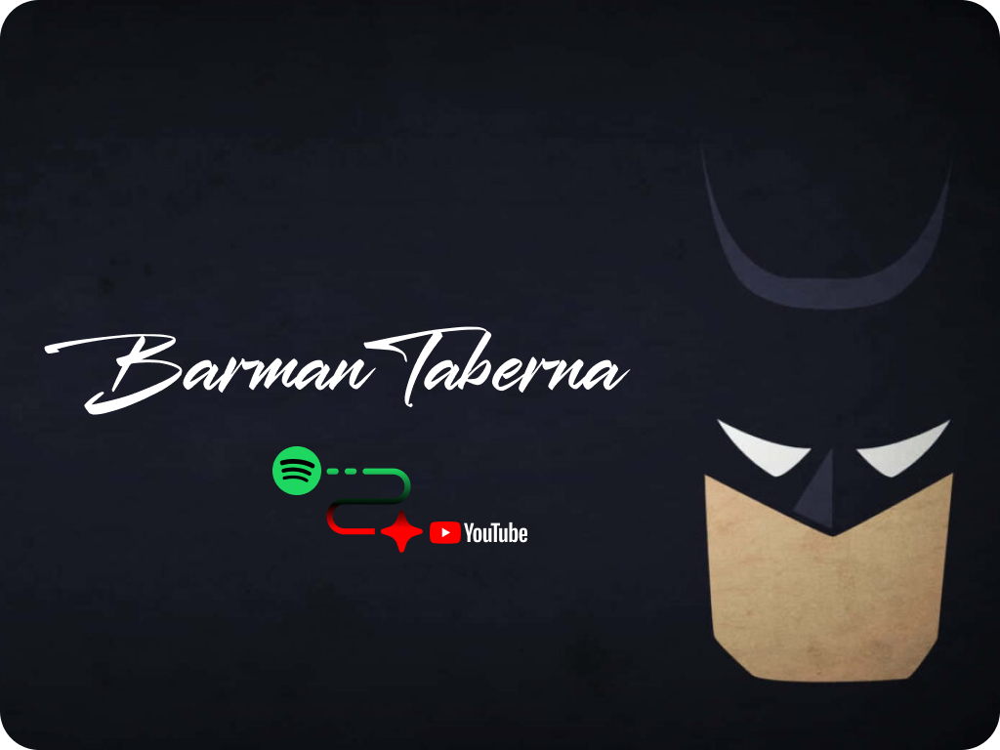
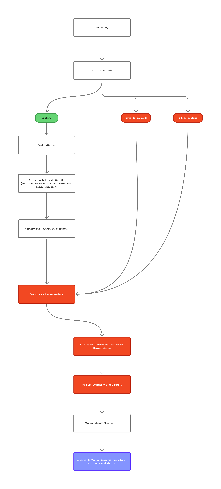

 <div align="center">
  
</div>

<div align="center">


</div>

# Barman de la Taberna

**Un bot de Discord, medio borracho pero buena onda, diseñado para moderar, interactuar con miembros y ejecutar música en los canales de voz.**

Barman de la Taberna es un proyecto enfocado actualmente en la reproducción de música desde YouTube, tiene integrado un Algoritmo para captar URL's y URI's de Spotify para luego obtener información de las
canciones y encontrarlas en YouTube.

Está hecho con `discord.py`, `yt-dlp`, `spotipy` y `FFmpeg`. El proyecto se enfoca en una arquitectura limpia, operaciones asíncronas, una experiencia de música inolvidable y **libre de implementación de IA**.

## Arquitectura

El proyecto separa lo que son los comandos de Discord de las fuentes de audio para manejar la música.
El proyecto separa bien lo que son los comandos e interacciones de discord de las fuentes de audio para manejar la música. A continuación, expongo un flujograma que muestra el funcionamiento del bot músical:
<div align="center">
  
  <p>Perdón por la imagen gigante... :S</p>
</div>

Puede ser raro ver de entrada el flujograma y ver nombres como **Music Cog** sin entender que es, yo te lo aclaro.

El **Music Cog** es el módulo que se encarga de las interacciones con discord y coordina la reproducción de música con los algoritmos implementados para interactuar con los metadatos de **Spotify** y **YouTube**, como también, ejecuta el motor `YTDLSource` de `BarmanTaberna` que se ocupa de extraer la información de audio, prepara las fuentes de audio para `FFmpeg` y gestiona, como se dijo previamente, los metadatos de reproducción de **YouTube**.

El párrafo anterior es un resumen de lo que es el bot de música, hay varios intermediarios en el medio.

Por un lado, tenemos a `SpotifySource`, que como se ve en el flujograma, maneja el flujo de reconocimiento de las canciones proporcionada por el **usuario** en el canal de texto de Discord, que pueden ser proporcionadas por **URL** o **URI**, y luego, conseguido eso, se ocupa de conseguir y guardar en `SpotifyTrack` la metadata de la canción.
Si te interesa ver mejor que es una **URL** o **URI**, te lo muestro facil en un ejemplo, pero para resumirtelo, la **URL** de Spotify es la de toda la vida, que arranca con el `open.spotify.com`, y la **URI** arranca con el `spotify:track:algun_id`:

```text
URL: https://open.spotify.com/intl-es/track/4C4Xa4ChCQr7cfTFdd5abC?si=fb0c6a21884f49c0 (mi canción favorita btw).
URI: spotify:track:4C4Xa4ChCQr7cfTFdd5abC (es la misma canción de arriba).
```
Aclarado esto, despues guardar en `SpotifyTrack` la metadata, eso entra en el algoritmo que se creo para este bot, llamado **YTDLSource**, el cual se ocupa de extraer la metadata que se recolecto de **Spotify**, si es que se paso una **URL** o **URI** de **Spotify**, y, sino, se ocupa de buscar la canción mediante el nombre de la canción, o el nombre del artista, como también, acepta **URL's** de **YouTube**.

> [!NOTE]
> Nota de color, como dije previamente, la canción puede ser pasada mediante URL o URI de Spotify, este mismo se utiliza para obtener la metadata de las canciones. El audio reproducido por el bot se obtiene mediante YouTube y se procesa utilizando `yt-dlp` y `FFmpeg`.

# Comandos

El Barman tiene comandos para poner música y también para mantener el orden en la taberna. Porque una cosa es tomarse unas birras y otra es empezar a romper toda la taberna.

### 🎵 Comandos de música

Los comandos musicales utilizan los **Slash Commands** de Discord, es decir, el prefijo `/`.

| Comando | Descripción | Parámetro |
| ------- | ----------- | --------- |
| `/join` | Conecta el bot a un canal de voz específico. | `channel` |
| `/play` | Reproducí cualquier canción de YouTube o un link de Spotify. | `cancion` |
| `/stop` | Detiene la reproducción y desconecta al bot. | Ninguno |

### 🛡️ Comandos de moderación

Los comandos de moderación utilizan el prefijo `!`. Estos están pensados para mantener el orden dentro del servidor, discretamente, porque el barman de la taberna es un picante y no va con chiquitaje cuando se enoja.

| Comando | Descripción | Parámetro |
| ------- | ----------- | --------- |
| `!clear` | Elimina mensajes de un canal de texto. | `cantidad (1-100)` |
| `!kick` | Expulsa a un miembro del servidor. | `@usuario [razón opcional]` |
| `!ban` | Banea a un usuario del servidor. | `@usuario [razón opcional]` |
| `!unban` | Revierte el baneo de un usuario. | `ID del usuario [razón opcional]` |
| `!timeout` | Restringe temporalmente a un miembro del servidor. | `@usuario minutos [razón opcional]` |
| `!untimeout` | Elimina la restricción de un miembro. | `@usuario ID_del_servidor` |

> [!IMPORTANT]
> Para utilizar los comandos de moderación, el usuario y el Barman deben contar con los permisos correspondientes dentro del servidor. Porque el Barman podrá estar borracho, pero no le entrega las llaves de la taberna a cualquiera.

> [!NOTE]
> Los parámetros entre corchetes `[]` son opcionales. Los demás son obligatorios.
>
> Para utilizar `!unban`, necesitás el ID del usuario baneado, ya que no se encuentra dentro del servidor.

### 🍺 Eventos de miembros

Además de reproducir música y moderar, el Barman también se ocupa de recibir y despedir a los miembros de la taberna (porque es educado aunque esté borracho).

- **Bienvenida**: Cuando alguien entra al servidor, el Barman lo recibe con una birra, una imagen falopa y un mensaje personalizado al MD.
- **Despedida**: Cuando alguien abandona el servidor, el Barman se pone triste, se toma unas birras en su honor y le dedica un último mensaje al MD.

Por otro lado, en los canales de `#bienvenida` y `#despedida` se publican Embeds de ***bienvenida y despedida***

# Tecnologías

| Tecnología | Objetivo |
| ---------- | --------- |
| Python | Lenguaje de programación elegido por la facilidad de implementación que tiene sus librerías para este bot. |
| discord.py | Integración con la API de Discord y reproducción de voz. |
| yt-dlp | Extracción de fuentes de audio. |
| spotipy | Integración de metadatos de Spotify. |
| FFmpeg | Decodificación y transmisión de audio. |
| asyncio | Operaciones asíncronas. |

# Preparando el entorno del Bot [Instalación y Pre-requisitos]

Antes de intentar ejecutar el bot, tenemos que estar seguros de algunas cosas:

### Pre-requisitos

- `Python`: Lo tenés que tener instalado. Si no lo tenés, descargá el ejecutable en su página:

  **-->** [Descargar Python](https://www.python.org/downloads/)
  
  Para este proyecto yo utilicé ***Python 3.11.5***, pero la versión que recomiendo que instales en tu maquina es ***Python 3.14.8***

- `FFmpeg`: Tiene que estar **sí o sí** instalado. Si no lo tenés, podés descargarlo acá:

  **-->** [Descargar FFmpeg](https://ffmpeg.org/download.html)

  Si querés saber cómo instalar FFmpeg, te recomiendo estos tutoriales:

  **-->** **Windows**: [Tutorial de instalación](https://www.youtube.com/watch?v=KBnyOH1o5Ms)

  **-->** **Linux**: [Tutorial de instalación](https://www.youtube.com/watch?v=ieY22NE0N7o)

  **-->** **macOS**: [Tutorial de instalación](https://www.youtube.com/watch?v=KAMuQTmGJUI)

> [!IMPORTANT]
> `FFmpeg` tiene que estar disponible en el `PATH` de tu sistema operativo para que el bot pueda utilizarlo.

  Podés verificar la instalación ejecutando:

  ```bash
  ffmpeg -version
  ```

- Necesitás, por otro lado, una aplicación de Discord y un **token** para tu bot.
  
  Te recomiendo fuertemente que veas la página de Desarrolladores de Discord, si es que no estas al tanto de esta misma:
  
  **-->** [Discord Developer Portal](https://discord.com/developers)
  
  Cuando llegues a esa página, en la pestaña **Developers** elegí la opción **Developers Portal**, ahi haces todo el tramiterio para tu bot y el token.

- Credenciales API para Spotify (Web API), esto es lo más facil te diria, tenes que ir nada más a la página de **Spotify
Developers**, conectas tu cuenta y reclamas las credenciales.

### Cloná el repositorio

Vas a necesitar clonar el repositorio, si no tenes una cuenta específicada en **ssh**, que es algo que muchas veces se utiliza en diferentes distribuciones de Linux, te recomiendo que clones directamente en **HTTPS**, siguiendo los siguientes pasos:

```bash
git clone https://github.com/rodrigorierafiuba/barman-taberna-bot.git
```

Después andá a la raíz del proyecto:

```bash
cd barman-taberna-bot
```
Y listo!

### Instalá las dependencias

Este proyecto utiliza [uv](https://docs.astral.sh/uv/), y recomiendo fuertemente que lo uses. Ya sé que hay gente que está acostumbrada capaz a utilizar `pip`, pero sinceramente `uv` te cambia la vida y es muy simple de utilizar a lo largo del proyecto.

- Te recomiendo instalar `uv` acá:

  [Documentación e Instalación de uv](https://docs.astral.sh/uv/getting-started/installation/)

  La documentación esta muy linda, asi que tranqui, es re facil de configurar!

Por otro lado, para sincronizar las librerías utilizadas del proyecto, corré el siguiente comando:

```bash
uv sync
```

### Configurá las variables de entorno

> [!IMPORTANT]
> Configurá el token de tu bot de Discord y las credenciales de Spotify usando un archivo `.env`.

Las variables que tendrías que utilizar son las siguientes:

```dotenv
DISCORD_TOKEN=tu_token_de_discord
SPOTIFY_CLIENT_ID=tu_client_id
SPOTIFY_CLIENT_SECRET=tu_client_secret
```

> [!WARNING]
> Creo que no te tengo que decir esto, pero por las dudas, nunca subas el `.env` a un repo, siempre el primer paso es guardar eso en el .gitignore


### Lanzamiento de tu Bot

Antes de ejecutar la aplicación del Bot, tenés que agregarlo a tu servidor de Discord. Para eso, podés invitarlo utilizando el link que encontrás en el **Discord Developer Portal**,
dentro de la configuración de tu aplicación.

Una vez que el Barman tenga las puertas abiertas de tu taberna, ejecutá el siguiente comando en la terminal:

```bash
uv run python -m discord_bot.bot
```

Y listo! Tenes a tu bot corriendo en tu servidor y preparado para mandarse unos temas, moderar e interactuar de vez en cuando con los miembros!

## Hoja de ruta

Las siguientes funcionalidades están previstas para futuras versiones:

- [ ] Soporte de listas de reproducción.
- [ ] Sistema de cola musical.
- [ ] Comando `/skip`.
- [ ] Modificar `/stop` para detener la reproducción sin desconectarse.
- [ ] Comando `/disconnect`.
- [ ] Integración con proveedores musicales adicionales [En revisión, pero posible].
- [ ] Mejor manejo de videos restringidos o no disponibles.
- [ ] Mejoras en la recuperación de errores.
- [ ] Desconectar al bot si esta mucho tiempo inactivo.

El progreso del proyecto se organizará mediante ***GitHub Issues, Pull Requests y Milestones***.

## Contribuciones

Las contribuciones por el momento están cerradas, pero cualquier sugerencia o reporte de bug es bienvenido.
Si encontrás un problema o tenés una idea para una nueva característica, sentite libre de generar un **Issue**.

## Licencia

La información de la licencia va a ser agregada una vez que haya sido seleccionada.
